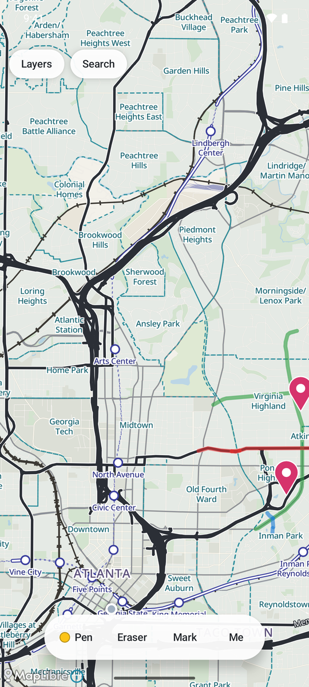
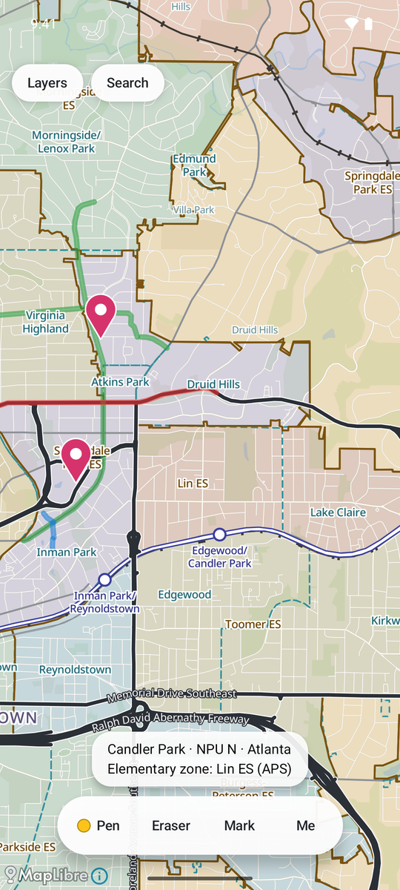
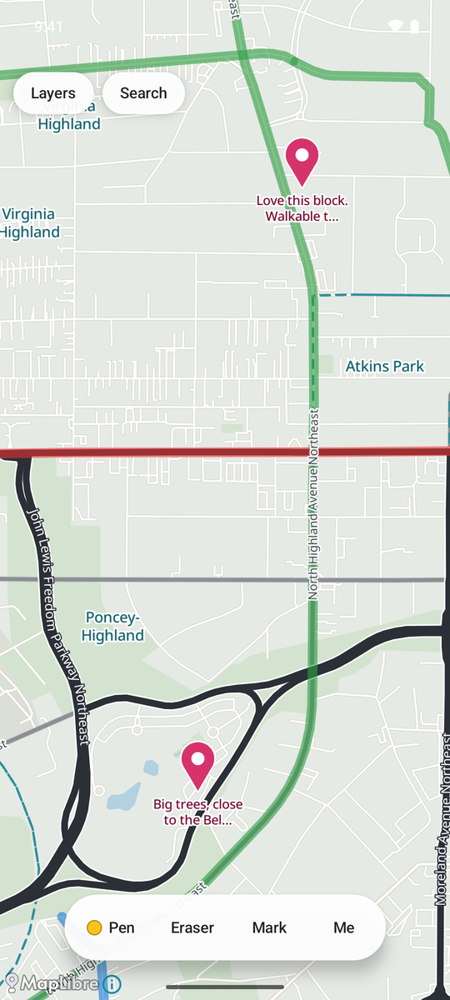
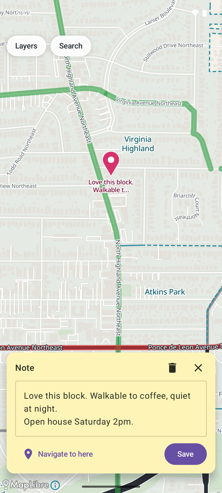
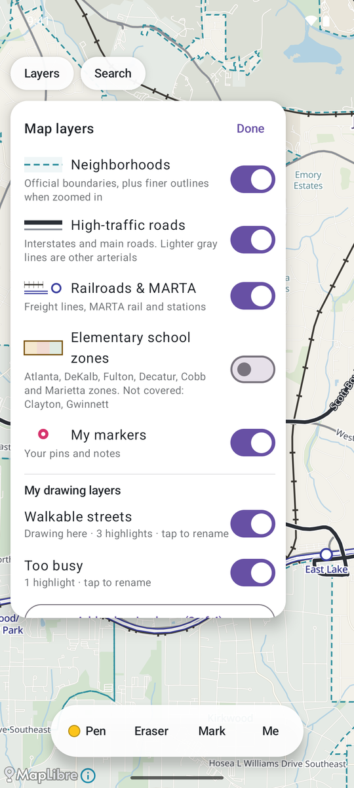

# ATL House Hunter

**An Android app for deciding which Atlanta neighborhood to live in.** It's an offline map of Atlanta (everything inside
I-285, plus Sandy Springs) that shows the things that matter when choosing where to live, such as neighborhood
boundaries, busy roads, railroads, MARTA and elementary school zones. You can mark it up yourself as you explore.

<table>
  <tr>
    <td align="center"><br><sub>Neighborhoods, MARTA &amp; rail</sub></td>
    <td align="center"><br><sub>Elementary school zones</sub></td>
    <td align="center"><br><sub>Highlight streets, drop pins</sub></td>
    <td align="center"><br><sub>Notes &amp; directions</sub></td>
    <td align="center"><br><sub>Layers &amp; your own drawing layers</sub></td>
  </tr>
</table>

## Download and install (Android)

**[⬇ Download the latest version](https://github.com/jacobkimball/atl_house_hunter/releases/latest)**: on that page,
tap the `.apk` file under **Assets**.

It's free, and works on any Android phone running Android 8.0 or newer. The download is about 110 MB, because the whole
Atlanta map is built in so the app works without a signal.

1. **On your Android phone**, open the link above and tap the `.apk` file to download it.
2. **Open the downloaded file** (from the download notification, or your Files app).
3. Your phone will say it can't install apps from this source. Tap **Settings**, turn on **Allow from this source**,
   then go back. This is normal for any app that isn't from the Google Play Store.
4. Tap **Install**. If Google Play Protect warns that it doesn't recognize the developer, tap **More details →
   Install anyway**.
5. Open **House Hunter** from your app drawer. It asks for your location so it can show where you are. That's
   optional, and everything else works without it.

**Updating:** download the newer `.apk` from the same link and install it over the old one. Your notes and drawings are
kept. (Uninstalling the app deletes them, so use **Back up & restore** first if you ever need to.)

**iPhone:** not available. The app is Android only for now.

## What you can do with it

- **See the city at a glance:** official Atlanta neighborhood boundaries and names (plus Sandy Springs and Brookhaven
  subdivisions); high-traffic roads drawn bold; freight railroads (CSX, Norfolk Southern) shown separately from MARTA
  rail; all 37 MARTA stations; and every street name.
- **Check elementary school zones:** turn on the school zones layer and tap anywhere to see which elementary school
  serves it. Covers Atlanta Public Schools, DeKalb, Fulton, City Schools of Decatur, Cobb and Marietta City Schools.
  *(Zones change. Always confirm with the school district; see the disclaimer below.)*
- **Highlight streets:** a pen with six colors. Draw roughly along a street and it snaps onto the street for you, around
  corners and through intersections. Turn snapping off to draw freehand. There's an eraser, plus undo and redo.
- **Keep separate drawing layers:** up to four, each with its own name (for example "Commute" or "Walkable streets")
  and its own on/off switch.
- **Drop pins with notes:** tap **Mark**, drag the crosshair to a spot, and tap **Mark** again to place a pin and
  write a note. Tap a pin later to read or edit it, or to get **driving directions there** in Google Maps.
- **Search:** find any neighborhood, street, MARTA station or town, or search the text of your own notes.
- **Find yourself:** your current location on the map, with a **Me** button to jump back to it.
- **Declutter:** the **Layers** button shows or hides each layer and doubles as the map key.
- **Back up your work:** export your pins, notes and drawings to a single file (for example to Google Drive), and
  import them on a new phone.
- **Works offline:** the map is stored on your phone, so it works with no signal, which is handy while touring
  neighborhoods.

**Your data stays on your phone.** The app has no account and no ads, and doesn't track you. Nothing you draw or write
is uploaded anywhere. Your location is only used while the app is open, to show where you are.

## Map coverage

Everything inside the I-285 perimeter, plus Sandy Springs. School zones cover about 93% of that area. The parts of
Clayton County near the airport and the edge of Gwinnett County don't have school zone data.

## Disclaimer

This is a personal project, not affiliated with or endorsed by any city, county, school district or data provider
listed below. The map data, and **the school zones in particular**, are approximate and may be out of date: some zones
were traced from PDF maps, and districts redraw zones over time. **Always confirm a school assignment with the school
district before making any decision based on it.**

## Data sources & licenses

| Data | Source | Notes |
|---|---|---|
| Streets, railroads, MARTA stations and place names, and the street network, rail, station and search files built from them | © [OpenStreetMap contributors](https://www.openstreetmap.org/copyright) | Available under the [Open Database License (ODbL)](https://opendatacommons.org/licenses/odbl/). The files derived from it are shared under the same license. |
| Map tiles | [Protomaps](https://protomaps.com) build of OpenStreetMap | ODbL, as above. |
| Map label fonts | Noto Sans, via [Protomaps basemaps-assets](https://github.com/protomaps/basemaps-assets) | SIL Open Font License (`data/assets/glyphs/OFL.txt`). |
| Atlanta neighborhoods | City of Atlanta Department of City Planning open data | Official neighborhood boundaries. |
| Sandy Springs and Brookhaven subdivisions | City of Sandy Springs and City of Brookhaven GIS open data | |
| School zones: DeKalb County | DeKalb County School District's published zone data | |
| School zones: Fulton County | Fulton County Schools' published zone data (2026–27) | |
| School zones: Atlanta Public Schools | A public ArcGIS layer compiled by a third party (Aug 2026) | Not an official APS file. Credit to its compiler. |
| School zones: City Schools of Decatur | Traced from the district's official 2025–26 boundary map (PDF) | |
| School zones: Cobb County | Traced from the district's official 2023–24 elementary zone map (PDF) | Older than the other zone data. |
| School zones: Marietta City Schools | Built from the City of Marietta's public parcel records | The city states that users must verify any information derived from its GIS data. |

School ratings (such as GreatSchools) are deliberately not included: their terms don't allow bundling them in an app.

## License

The app's source code is released under the [MIT License](LICENSE).

The map data in `data/assets/` is **not** covered by the MIT License. It stays under the terms of its sources listed
above: in particular, the files built from OpenStreetMap remain under the ODbL.

---

## For developers

Native Android app in Kotlin and Jetpack Compose, using [MapLibre](https://maplibre.org) for the map. The design notes
and the original feature list are in [requirements.md](requirements.md).

### Build and run

Requires JDK 17 and the Android SDK (platform 35).

```bash
./gradlew :app:assembleDebug
adb install -r app/build/outputs/apk/debug/app-debug.apk
./gradlew :app:testDebugUnitTest      # 60 unit tests
```

On an emulator, turn on GPU rendering (`hw.gpu.enabled=yes` in the AVD's `config.ini`), or the map renders very slowly.
`adb emu geo fix -84.388 33.749` fakes a location. Because adb can't pinch, the app accepts a starting camera when
launched from adb: `adb shell am start -n com.househunter.app/.MainActivity --ef lat 33.775 --ef lon -84.295 --ef zoom 14.3`.

**Release builds** are signed with a keystore that isn't in this repository. To build your own signed release, create
a `keystore.properties` in the project root (`storeFile`, `storePassword`, `keyAlias`, `keyPassword`) pointing at your
own keystore, then run `./gradlew :app:assembleRelease`. Note that an APK signed with a different key can't be
installed over one from the Releases page.

### Project layout

| Path | What's there |
|---|---|
| `app/src/main/java/com/househunter/app/` | The app. `MapScreen.kt` is the main screen and touch handling. `SnapMatcher.kt` and `RoadGraph.kt` do snap-to-street. `Stroke.kt` holds the highlights, eraser and drawing layers. `Backup.kt` is the export file format, `SearchIndex.kt` is search. |
| `app/src/main/assets/style.json` | How the map looks (colors, line widths, labels, layer order). |
| `app/src/test/` | Unit tests, including snap-to-street measured on the real Atlanta street network. |
| `data/assets/` | The map data bundled into the app, all generated by the scripts below. |
| `data/*.py`, `data/build_data.sh` | Scripts that download the sources and rebuild everything in `data/assets/`. Each script's header documents its source, method and accuracy checks. |

### Rebuilding the map data

`data/build_data.sh` regenerates everything in `data/assets/`. It needs the `pmtiles` command-line tool, a Python
virtual environment in `.venv` with `osmium`, `shapely`, `mapbox-vector-tile`, `pymupdf`, `numpy` and `scipy`, and the
Georgia OpenStreetMap extract (`data/source/georgia-latest.osm.pbf`, about 350 MB from
[Geofabrik](https://download.geofabrik.de/north-america/us/georgia.html), not committed).

The school zones come from six districts, each published differently:
- **DeKalb, Fulton and APS:** fetched from their GIS layers.
- **Decatur and Cobb:** traced from the districts' PDF maps. `build_decatur_zones.py` and `build_cobb_zones.py` read
  the vector shapes, then place them on the map by matching against county outlines and real roads, and refuse to
  produce output if the fit is poor.
- **Marietta:** built from city parcel records.

`data/verify_school_zones.py <school name>` cross-checks any zone against independent official data.

### Known gaps and ideas

Not built yet: moving a pin after it's placed, a dark theme, and color-blind-friendly highlight outlines. Possible
future directions (an iPhone version, other cities, swim/tennis community markers) are written up in
[requirements.md §15](requirements.md).
